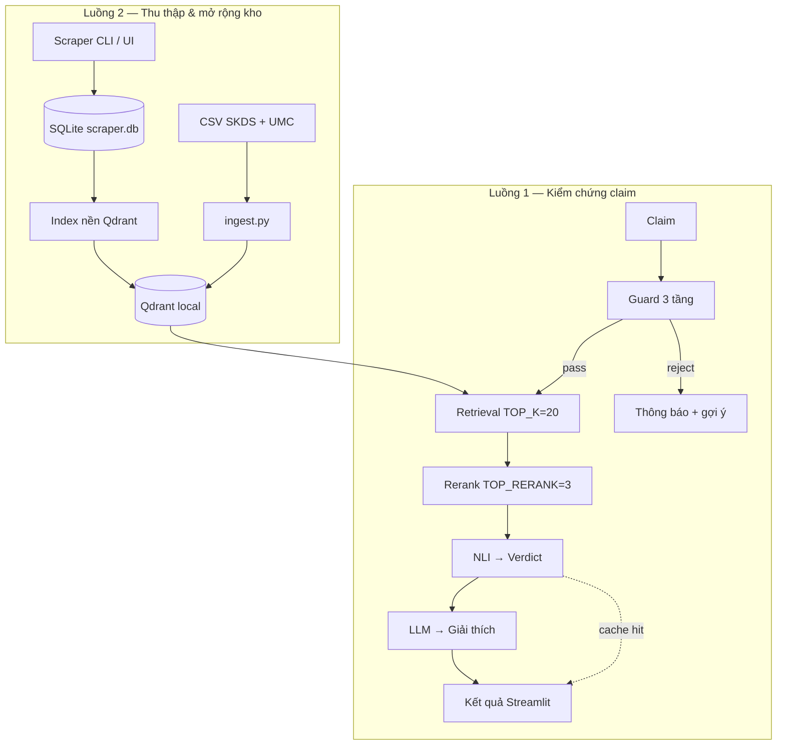
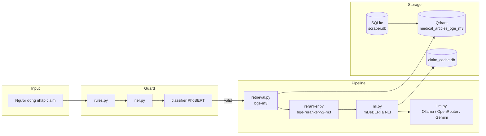

# Hệ thống Kiểm chứng Thông tin Y tế (Medical Fact-Checking)

Hệ thống hỗ trợ kiểm chứng tính đúng/sai của các phát biểu y tế bằng cách đối chiếu với kho bài viết y khoa đáng tin cậy. Dự án kết hợp **Guard 3 tầng** (lọc input), **Retrieval-Augmented Generation (RAG)**, **reranking**, **Natural Language Inference (NLI)** và **LLM** (giải thích) để đưa ra kết luận kèm bằng chứng cho người dùng phổ thông.

Ngoài pipeline kiểm chứng, hệ thống còn có **module thu thập tin tức** (scraper) tự động crawl bài báo y tế, lưu SQLite và **nạp incremental vào Qdrant** để mở rộng kho bằng chứng cho RAG.

---

## Mục lục

- [Tổng quan](#tổng-quan)
- [Kiến trúc hệ thống](#kiến-trúc-hệ-thống)
- [Pipeline kiểm chứng (Guard → RAG → NLI)](#pipeline-kiểm-chứng-guard--rag--nli)
- [Guard 3 tầng](#guard-3-tầng)
- [Cache kết quả (demo)](#cache-kết-quả-demo)
- [Module thu thập & index dữ liệu](#module-thu-thập--index-dữ-liệu)
- [Giao diện Streamlit](#giao-diện-streamlit)
- [Lớp dữ liệu](#lớp-dữ-liệu)
- [Công nghệ & mô hình](#công-nghệ--mô-hình)
- [Cấu trúc thư mục](#cấu-trúc-thư-mục)
- [Yêu cầu hệ thống](#yêu-cầu-hệ-thống)
- [Hướng dẫn cài đặt](#hướng-dẫn-cài-đặt)
- [Hướng dẫn sử dụng](#hướng-dẫn-sử-dụng)
- [Cấu hình](#cấu-hình)
- [Đánh giá hệ thống](#đánh-giá-hệ-thống)
- [Kết quả đầu ra](#kết-quả-đầu-ra)
- [Xử lý sự cố](#xử-lý-sự-cố)
- [Lưu ý bảo mật](#lưu-ý-bảo-mật)

---

## Tổng quan

Trong bối cảnh thông tin y tế trên mạng xã hội ngày càng nhiều, người dùng khó phân biệt đâu là thông tin đúng, đâu là tin giả. Hệ thống cho phép nhập một **phát biểu (claim)** — ví dụ: *"uống nước chanh chữa ung thư"* — và nhận về:

| Kết luận | Ý nghĩa |
|----------|---------|
| **ĐÚNG** | Bằng chứng ủng hộ phát biểu |
| **SAI** | Bằng chứng mâu thuẫn với phát biểu |
| **KHÔNG ĐỦ BẰNG CHỨNG** | Không có đủ căn cứ để kết luận |

Kèm theo **giải thích tiếng Việt** và **các đoạn bài viết tham khảo** trích từ kho dữ liệu y khoa.

### Hai luồng chính



| Luồng | Mục đích | Điểm vào |
|-------|----------|----------|
| **Kiểm chứng** | Guard → đối chiếu claim với bằng chứng → verdict | `app.py`, `pages/kiem_chung.py`, `pipeline.py` |
| **Thu thập dữ liệu** | Crawl bài báo mới, lưu DB, nạp vector | `scraper/`, các trang `pages/` |

> **Quan trọng:** Kết luận **ĐÚNG / SAI / KHÔNG ĐỦ BẰNG CHỨNG** đến từ **mô hình NLI**, không phải LLM. LLM chỉ sinh **giải thích** dễ hiểu cho người dùng.

---

## Kiến trúc hệ thống



### Các thành phần chính

| Thành phần | File | Vai trò |
|------------|------|---------|
| Giao diện | `app.py` + `pages/kiem_chung.py` | Streamlit — navigation, nhập claim, hiển thị verdict |
| Theme UI | `ui/theme.py` | CSS chung, logo sidebar |
| Guard | `guard/` | Lọc input trước pipeline (rule → NER → classifier) |
| Pipeline | `pipeline.py` | Ghép retrieval → rerank → NLI → LLM explanation |
| Cache | `claim_cache.py` | SQLite cache kết quả claim (TTL 2h, phục vụ demo) |
| Retrieval | `retrieval.py` | Semantic search trong Qdrant (`TOP_K=20`) |
| Reranker | `reranker.py` | Cross-Encoder chọn `TOP_RERANK=3` đoạn phù hợp nhất |
| NLI | `nli.py` | Phân loại quan hệ claim–evidence, aggregate multi-chunk |
| LLM | `llm.py` | Sinh giải thích tiếng Việt; hỗ trợ baseline LLM-only / RAG+LLM |
| Ingest bulk | `ingest.py` | CSV → chunk → embed → Qdrant (rebuild toàn bộ) |
| Qdrant client | `qdrant_store.py` | Singleton client + lock đa luồng |
| Scraper | `scraper/` | Crawl báo, SQLite, index incremental Qdrant |
| Đánh giá | `evaluation/` | Benchmark retrieval, NLI, LLM, E2E, baselines |
| Duyệt Qdrant | `browse_qdrant.py` | Streamlit tool xem/search vector DB |

---

## Pipeline kiểm chứng (Guard → RAG → NLI)

### Luồng xử lý chi tiết

**UI:** `pages/kiem_chung.py` gọi `guard.check_claim()` trước, chỉ khi pass mới gọi `verify_claim()`.

Hàm chính: `verify_claim(claim, with_explanation=True, use_cache=True)` trong `pipeline.py`.

```
0. Guard (chỉ trên UI — không chạy trong eval)
   └─ Tầng 1 rules: loại câu hỏi, ý kiến, chẩn đoán cá nhân, mệnh lệnh
   └─ Tầng 2 NER: trích entity y khoa từ gazetteer
   └─ Tầng 3 classifier PhoBERT: factual_claim vs other

1. Cache (tuỳ chọn, mặc định bật trên UI)
   └─ Hit → trả kết quả đã lưu (TTL 2 giờ)

2. retrieve(claim)
   └─ Encode claim bằng BAAI/bge-m3
   └─ Cosine search trong Qdrant → lấy TOP_K=20 chunks

3. rerank(claim, docs)
   └─ Cross-Encoder BAAI/bge-reranker-v2-m3
   └─ Chọn TOP_RERANK=3 đoạn có điểm cao nhất

4. predict_nli_ess(claim, top_docs, score_texts)      [VERDICT_STRATEGY="ess", mặc định]
   └─ NLI 3 chunk + weighted_max → có kết luận hay KHÔNG ĐỦ BẰNG CHỨNG
   └─ ESS: tách câu, cross-encoder chọn ESS_TOP_M=5 câu sát claim nhất
   └─ NLI trên các câu được chọn → ĐÚNG hay SAI (+ trả về "key_sentences" cho UI)
   (VERDICT_STRATEGY="weighted_max" = pipeline gốc, chỉ dùng mức chunk)

5. explain(claim, evidence, verdict)   [nếu with_explanation=True]
   └─ LLM sinh giải thích tiếng Việt
```

### Logic NLI (`weighted_max`)

Mô hình NLI gán nhãn gốc: `entailment`, `contradiction`, `neutral` → ánh xạ sang tiếng Việt:

| Nhãn NLI | Verdict |
|----------|---------|
| `entailment` | ĐÚNG |
| `contradiction` | SAI |
| `neutral` | KHÔNG ĐỦ BẰNG CHỨNG |

Chiến lược `weighted_max` (mặc định):
- Lấy **max** điểm entailment và contradiction trên các chunk
- So sánh **margin** so với điểm neutral trung bình
- Chỉ chấp nhận ĐÚNG/SAI khi margin > 0.3 (tránh nhầm bằng chứng chỉ *liên quan chủ đề* thành *ủng hộ*)
- Fallback: contradiction > 0.5 → SAI; còn lại → KHÔNG ĐỦ BẰNG CHỨNG

### Cải tiến ESS và thí nghiệm ablation

Thiết kế ESS được chọn **chỉ trên tập dev** (idx 100–249) và đánh giá trên tập test (100 mẫu đầu, trùng tập baseline cũ).
Hai mở rộng nhiều tham số (ngưỡng hiệu chỉnh τe/τc, cổng liên quan τr) đã thử nhưng overfit trên dev nên không bật.

```bash
# 1. Cache điểm retrieval/rerank/NLI (nặng, chạy 1 lần; ~8 s/claim trên Apple M2)
python -m evaluation.ablation_cache --dataset viet_medfact --mode e2e --max-samples 250
python -m evaluation.ablation_cache --dataset vifactcheck  --mode oracle --max-samples 250
python -m evaluation.ablation_cache --dataset vifactcheck  --mode e2e --max-samples 250
# 2. Tính mọi biến thể + bootstrap CI + McNemar + CV lặp (nhẹ, vài phút)
python -m evaluation.ablation_analyze --dataset viet_medfact --mode e2e
# 3. Đánh giá Guard theo tầng
python -m evaluation.eval_guard
```

Kết quả: `evaluation/results/ablation/summary_*.json`, `evaluation/results/guard_results.json`.

### Pipeline thay thế (dùng trong đánh giá baseline)

| Hàm | Mô tả |
|-----|-------|
| `verify_claim()` | **Chính thức** — RAG + NLI verdict + LLM giải thích |
| `verify_claim_llm_only()` | LLM phân loại không có retrieval |
| `verify_claim_rag_llm()` | Retrieval + rerank, LLM phân loại từ evidence |

### Ví dụ gọi trong code

```python
from pipeline import verify_claim

# Đầy đủ (có giải thích LLM)
result = verify_claim("ăn kẹo sẽ gây sâu răng")

# Chỉ verdict + bằng chứng (nhanh hơn, dùng khi đánh giá E2E)
result = verify_claim("ăn kẹo sẽ gây sâu răng", with_explanation=False)

print(result["verdict"])        # ĐÚNG / SAI / KHÔNG ĐỦ BẰNG CHỨNG
print(result["verdict_score"])  # 0.0 – 1.0
print(result["explanation"])    # Giải thích tiếng Việt
print(result["evidence_docs"])  # [{"text": "...", "score": 0.87}, ...]
```

---

## Guard 3 tầng

Module `guard/` lọc input **trước** khi nạp embedding / NLI / LLM — tiết kiệm tài nguyên và cải thiện UX.

```
Input claim
    │
    ▼
┌─────────────────┐
│ T1: rules.py    │── reject: question, opinion, diagnosis, command, too_short
└────────┬────────┘
         │ pass
         ▼
┌─────────────────┐
│ T2: ner.py      │── gazetteer data/gazetteer/*.txt → feature (không tự reject)
└────────┬────────┘
         ▼
┌─────────────────┐
│ T3: classifier  │── PhoBERT fine-tuned models/guard_phobert
└────────┬────────┘
         │
    valid / reject + message tiếng Việt
```

| Tầng | File | Vai trò |
|------|------|---------|
| 1 — Rules | `guard/rules.py` | Regex/cue list — câu hỏi, ý kiến, chẩn đoán cá nhân, mệnh lệnh |
| 2 — NER | `guard/ner.py` | Longest-match gazetteer: bệnh, thuốc, chất, triệu chứng |
| 3 — Classifier | `guard/classifier.py` | PhoBERT phân loại `factual_claim` vs `other` |

**NER-assist:** Nếu classifier cho `factual_claim` nhưng confidence < `GUARD_THRESHOLD` (0.5), vẫn **pass** khi có ≥ 1 entity y khoa và confidence ≥ `GUARD_NER_ASSIST_MIN_CONF` (0.35).

**Huấn luyện classifier:**

```bash
PYTHONPATH=. python scripts/train_guard_classifier.py \
  --data data/guard_train.csv \
  --out models/guard_phobert
```

**Kiểm thử:**

```bash
PYTHONPATH=. python -m pytest tests/test_guard.py -q
```

---

## Cache kết quả (demo)

`claim_cache.py` lưu kết quả `verify_claim()` vào SQLite `data/claim_cache.db`:

| Thuộc tính | Giá trị |
|------------|---------|
| Key | SHA256 của claim đã `normalize()` |
| Version | `CLAIM_CACHE_VERSION` + corpus/model config |
| TTL mặc định | 2 giờ (`CLAIM_CACHE_TTL_SECONDS`) |
| UI | Không hiện badge cache; vẫn có loading 1–2s khi cache hit |
| Xóa cache | Nút **Xóa cache** trong mục **Tuỳ chọn** trên trang kiểm chứng |

Script đánh giá chạy `use_cache=False` để không ảnh hưởng metric.

---

## Module thu thập & index dữ liệu

### Tổng quan scraper

Module `scraper/` thu thập bài báo theo **khoảng thời gian xuất bản**, lưu SQLite, và tự động đưa bài mới vào hàng đợi index Qdrant.

| Tính năng | Chi tiết |
|-----------|----------|
| Lọc theo thời gian | `from_time` → `to_time` (`YYYY-MM-DD HH:MM:SS`) |
| Dedupe | Trùng `title + source + publish_time` → bỏ qua |
| Quản lý nguồn | Mỗi báo có `scraper_key` riêng (HTML khác nhau) |
| Theo dõi job | Lịch sử scrape, số success/fail/skip |
| Index Qdrant | Tự động sau scrape; incremental, không rebuild toàn bộ |
| Export | CSV từ UI hoặc CLI |

### Nguồn hiện có

| Code | Tên | Scraper | URL |
|------|-----|---------|-----|
| `suckhoedoisong` | Sức khỏe & Đời sống | `skds` | `https://suckhoedoisong.vn/y-te.htm` |

**Cơ chế SKDS** (`scraper/sources/skds.py`):
1. Lấy `zone_id` từ trang chuyên mục (vd: `1691474`)
2. Phân trang qua API timeline: `/timelinelist/{zone_id}/{page}.htm`
3. Parse chi tiết: tiêu đề, nội dung, ngày xuất bản, tác giả, tags
4. Parse ngày ưu tiên định dạng hiển thị `DD/MM/YYYY` (tránh nhầm MM/DD)

### Schema SQLite (`data/scraper.db`)

Tự tạo khi gọi `db.init_db()` — không cần connection string.

**Bảng `sources`**

| Cột | Mô tả |
|-----|-------|
| `code` | Mã duy nhất (vd: `suckhoedoisong`) |
| `name`, `base_url`, `list_url` | Thông tin nguồn |
| `scraper_key` | Key parser (`skds`, ...) |
| `enabled` | Bật/tắt scrape |
| `config_json` | Cấu hình scraper (vd: `{"zone_id": 1691474, "max_pages": 40}`) |

**Bảng `scrape_jobs`**

| Cột | Mô tả |
|-----|-------|
| `from_time`, `to_time` | Khoảng thời gian scrape |
| `status` | `running` / `success` / `failed` |
| `total_found`, `success_count`, `failed_count`, `skipped_count` | Thống kê |

**Bảng `articles`**

| Cột | Mô tả |
|-----|-------|
| `title`, `publish_time`, `content`, `source`, `link` | Nội dung bài |
| `author`, `tags`, `related_one_news` | Metadata bổ sung |
| `scrape_status` | `success` / `failed` / `skipped_duplicate` |
| `index_status` | `pending` → `indexing` → `indexed` / `failed` |
| `index_chunks` | Số chunk đã nạp Qdrant (>0 = đã nạp) |
| `indexed_at`, `index_error` | Thời điểm index / lỗi |

**Ràng buộc:** `UNIQUE (title, source, publish_time)`

### Auto-index Qdrant (`scraper/qdrant_indexer.py`)

```
Scrape success
  → enqueue_articles(new_article_ids)     [mặc định auto_index=True]
  → Background thread "qdrant-indexer"
  → Chunk (CHUNK_SIZE=1000, OVERLAP=50)
  → Embed BAAI/bge-m3
  → Upsert Qdrant (idempotent)
  → Cập nhật index_status + index_chunks trong SQLite
```

| Khái niệm | Giá trị |
|-----------|---------|
| `article_id` trong Qdrant | `scrape_<sqlite_id>` (khác `skds_*` / `umc_*` từ CSV) |
| Point ID | UUID5 của `scrape_{id}#{chunk_idx}` |
| Collection | `medical_articles_bge_m3` (cùng collection với `ingest.py`) |
| Skip tự động | `index_status=indexed` **và** `index_chunks > 0` |

**Lưu ý vận hành:**
- Worker index là **thread daemon** trong tiến trình đang scrape — khi tiến trình Streamlit/CLI thoát sớm, các bài `pending` có thể chưa được index.
- **CLI** mặc định **chờ** index xong (`wait_until_idle`) trừ khi dùng `--no-wait-index`.
- **Streamlit:** sau scrape, vào trang **Bài đã scrape** → **Index pending/failed** để xử lý backlog.
- Qdrant local chỉ nên có **một process ghi** cùng lúc — tránh scrape/index khi `app.py` đang load pipeline RAG.

### CLI scraper

```bash
# Liệt kê nguồn
python -m scraper.cli --list-sources

# Scrape cả ngày
python -m scraper.cli --source suckhoedoisong --date 2026-07-12

# Scrape khoảng thời gian
python -m scraper.cli --source suckhoedoisong \
  --from "2026-07-12 00:00:00" --to "2026-07-12 23:59:59"

# Không auto-index Qdrant
python -m scraper.cli --date 2026-07-12 --no-index

# Không chờ index nền (thoát ngay sau scrape)
python -m scraper.cli --date 2026-07-12 --no-wait-index

# Index đồng bộ các bài pending/failed
python -m scraper.cli --index-pending

# Export CSV sau scrape
python -m scraper.cli --date 2026-07-12 --export data/articles_scraped.csv
```

---

## Giao diện Streamlit

Chạy một lần — sidebar có logo, menu nhóm rõ ràng:

```bash
streamlit run app.py
```

### Sidebar

| Nhóm | Trang |
|------|-------|
| **Kiểm chứng** | Kiểm chứng thông tin |
| **Quản lý dữ liệu** | Thu thập bài viết · Nguồn tin tức · Lịch sử thu thập · Kho bài viết |

### Trang chính — Kiểm chứng (`pages/kiem_chung.py`)

- **Guard 3 tầng** trước pipeline: rule → NER → PhoBERT
- Nhập khẳng định y tế → **Kiểm chứng ngay** (pipeline lazy-load lần đầu claim hợp lệ)
- Kết luận thân thiện: *Có thể đúng / Có thể sai / Chưa đủ căn cứ*
- Giải thích ngắn, nguồn tham khảo (có link nếu payload Qdrant/SQLite có)
- Gợi ý câu mẫu + hướng dẫn diễn đạt lại khi Guard từ chối
- Cache kết quả (TTL 2h) — tăng tốc demo, có nút xóa cache

### Trang 1 — Thu thập dữ liệu (`pages/1_Thu_thap_du_lieu.py`)

- Chọn nguồn báo, delay giữa request
- Chọn khoảng thời gian:
  - Preset: **Hôm nay**, **Hôm qua**, **7 ngày qua**, **Tháng này**
  - `date_input` Từ/Đến ngày
  - Checkbox **Cả ngày** (00:00:00 → 23:59:59) — mặc định bật
  - Tùy chọn nhập giờ chi tiết khi tắt "Cả ngày"
- Preview khoảng scrape + validate `from ≤ to`
- Log realtime + metrics (tìm thấy / thành công / thất bại / bỏ qua)
- Tự xếp hàng index Qdrant cho bài success mới

### Trang 2 — Quản lý nguồn báo (`pages/2_Quan_ly_nguon.py`)

- Xem danh sách nguồn, bật/tắt, sửa, xóa
- Thêm nguồn mới: `code`, `name`, URL, `scraper_key`, `config_json`
- Scraper key khả dụng: lấy từ `scraper/sources/`

### Trang 3 — Lịch sử scrape (`pages/3_Lich_su_scrape.py`)

- Danh sách job scrape (thời gian, trạng thái, thống kê)
- Xem bài thuộc từng job
- Thống kê index Qdrant theo trạng thái

### Trang 4 — Bài đã scrape (`pages/4_Bai_da_scrape.py`)

- Lọc theo nguồn, trạng thái scrape, trạng thái Qdrant
- Bảng bài viết + xem nội dung chi tiết
- **Index pending/failed** — xếp hàng nạp backlog
- **Reset + nạp lại** bài đang xem
- Export CSV (`data/articles_scraped.csv`)

### Công cụ phụ — Duyệt Qdrant (`browse_qdrant.py`)

```bash
streamlit run browse_qdrant.py
```

Tìm kiếm / duyệt chunks trong vector DB (debug, kiểm tra index).

---

## Lớp dữ liệu

### Ba kho lưu trữ

| Kho | Đường dẫn | Nội dung | Cách ghi |
|-----|-----------|----------|----------|
| **CSV gốc** | `data/articles_skds.csv`, `data/articles.csv` | Bài SKDS + UMC tĩnh | Import thủ công / export |
| **SQLite scraper** | `data/scraper.db` | Bài crawl mới + metadata index | Scraper tự ghi |
| **Cache claim** | `data/claim_cache.db` | Kết quả kiểm chứng (demo) | Tự tạo khi dùng UI |
| **Qdrant** | `qdrant_db/` | Vector chunks cho RAG | `ingest.py` (bulk) + `qdrant_indexer.py` (incremental) |

### Quy ước `article_id` trong Qdrant

| Nguồn | Pattern | Ví dụ |
|-------|---------|-------|
| CSV SKDS | `skds_{index}` | `skds_42` |
| CSV UMC | `umc_{index}` | `umc_1001` |
| Scraper | `scrape_{sqlite_id}` | `scrape_227` |

### CSV gốc

| File | Nguồn | Cột |
|------|-------|-----|
| `data/articles_skds.csv` | Sức khỏe & Đời sống | `title`, `content`, `source` |
| `data/articles.csv` | Bệnh viện Đại học Y Dược (UMC) | `id`, `title`, `publish_time`, `content`, `source`, `link` |

`ingest.py` mặc định đọc **cả hai** nguồn (`load_all()`).

### Xây dựng / rebuild Vector DB (bulk)

```bash
# Toàn bộ SKDS + UMC
python ingest.py

# Giới hạn số bài (test nhanh)
python ingest.py --max-rows 200
```

Quá trình:
1. Đọc CSV → gán `article_id`
2. Chunk: `CHUNK_SIZE=1000`, `CHUNK_OVERLAP=50`
3. Embed `BAAI/bge-m3` (CPU)
4. **Recreate** collection `medical_articles_bge_m3` (ghi đè toàn bộ)
5. Lưu payload: `article_id`, `title`, `source`, `text`

> `ingest.py` **rebuild toàn bộ** collection. Bài scrape incremental qua `qdrant_indexer.py` **upsert** thêm, không xóa dữ liệu CSV cũ.

---

## Công nghệ & mô hình

| Thành phần | Công nghệ / Model |
|------------|-------------------|
| Embedding | [BAAI/bge-m3](https://huggingface.co/BAAI/bge-m3) |
| Reranker | [BAAI/bge-reranker-v2-m3](https://huggingface.co/BAAI/bge-reranker-v2-m3) |
| NLI | [MoritzLaurer/mDeBERTa-v3-base-xnli-multilingual-nli-2mil7](https://huggingface.co/MoritzLaurer/mDeBERTa-v3-base-xnli-multilingual-nli-2mil7) |
| NLI fine-tuned | `models/nli_finetuned_mdeberta/checkpoint-235/` (tùy chọn) |
| Vector DB | [Qdrant](https://qdrant.tech/) embedded local |
| LLM giải thích | Ollama `qwen3:8b` (ưu tiên) → OpenRouter (free tier, failover 429) → Gemini |
| Giao diện | Streamlit |
| Scraper DB | SQLite3 |
| Guard classifier | `models/guard_phobert` (PhoBERT fine-tuned) |
| Guard NER | Gazetteer `data/gazetteer/*.txt` (~400+ thuật ngữ) |

| Framework | PyTorch, Hugging Face Transformers, Sentence-Transformers, LangChain, pyvi |

**Thiết bị:**
- Embedding / Reranker: **CPU** mặc định
- NLI: tự chọn **MPS → CUDA → CPU**

---

## Cấu trúc thư mục

```
fact_check/
├── app.py                      # Entry Streamlit — navigation + theme
├── pages/
│   ├── kiem_chung.py           # Trang kiểm chứng chính
│   ├── 1_Thu_thap_du_lieu.py
│   ├── 2_Quan_ly_nguon.py
│   ├── 3_Lich_su_scrape.py
│   └── 4_Bai_da_scrape.py
├── ui/theme.py                 # CSS + logo sidebar
├── static/brand.svg
├── .streamlit/config.toml      # Theme màu Streamlit
├── guard/                      # Guard 3 tầng (rules → NER → classifier)
│   ├── guard.py
│   ├── rules.py
│   ├── ner.py
│   └── classifier.py
├── claim_cache.py              # Cache SQLite kết quả claim
├── pipeline.py                 # RAG + NLI + LLM explanation
├── retrieval.py / reranker.py / nli.py / llm.py
├── ingest.py                   # Bulk CSV → Qdrant
├── qdrant_store.py
├── config.py                   # Model, API, Guard, cache
├── browse_qdrant.py
├── scripts/
│   └── train_guard_classifier.py
├── scraper/                    # Thu thập tin + index incremental
│   ├── cli.py / db.py / runner.py / qdrant_indexer.py
│   └── sources/skds.py
├── models/
│   ├── guard_phobert/          # Guard classifier (PhoBERT)
│   └── nli_finetuned_mdeberta/ # NLI fine-tuned (tùy chọn)
├── data/
│   ├── articles_skds.csv / articles.csv
│   ├── gazetteer/              # Từ điển Guard NER
│   ├── guard_train.csv
│   ├── scraper.db              # Tự tạo
│   └── claim_cache.db          # Tự tạo
├── tests/
│   ├── test_guard.py
│   └── test_claim_cache.py
├── evaluation/                 # Benchmark & báo cáo
│   ├── README.md
│   ├── ket_qua_danh_gia_day_du.md
│   ├── run_all.py / eval_*.py
│   ├── prepare_vifactcheck.py / index_vifactcheck.py
│   ├── data/                   # JSONL benchmark
│   └── results/                # JSON / PNG
├── evaluation.md               # Kế hoạch & kết quả đánh giá (tổng hợp)
├── qdrant_db/                  # Vector DB local
└── requirements.txt
```

---

## Yêu cầu hệ thống

- **Python**: 3.10+ (khuyến nghị 3.12)
- **RAM**: Tối thiểu 8 GB (khuyến nghị 16 GB khi tải nhiều model)
- **Ổ cứng**: ~5–10 GB (model Hugging Face + vector DB)
- **Internet**: Tải model lần đầu, gọi API LLM, crawl báo
- **API Key** (tùy chọn): OpenRouter / Gemini — hoặc dùng Ollama local

---

## Hướng dẫn cài đặt

### 1. Clone & tạo môi trường

```bash
git clone <url-repository>
cd fact_check
python3 -m venv .venv
source .venv/bin/activate        # macOS / Linux
pip install --upgrade pip
pip install -r requirements.txt
```

### 2. Cấu hình API (nếu dùng cloud LLM)

Sửa `config.py` hoặc dùng biến môi trường (khuyến nghị):

```bash
export OPENROUTER_API_KEY="sk-or-v1-your-key-here"
export GEMINI_API_KEY="your-gemini-key"
```

**Ollama local** (miễn phí, ưu tiên khi `OLLAMA_ENABLED=True`):

```bash
ollama pull qwen3:8b
ollama serve
```

### 3. Huấn luyện Guard (tùy chọn)

Nếu chưa có `models/guard_phobert`:

```bash
PYTHONPATH=. python scripts/train_guard_classifier.py \
  --data data/guard_train.csv \
  --out models/guard_phobert
```

### 4. Xây dựng Vector DB

```bash
python ingest.py                  # toàn bộ
python ingest.py --max-rows 200   # test nhanh
```

### 5. Chạy ứng dụng

```bash
streamlit run app.py
```

Mở `http://localhost:8501` → nhập claim → **Kiểm chứng ngay**.

### 6. Kiểm thử

```bash
PYTHONPATH=. python -m pytest tests/test_guard.py tests/test_claim_cache.py -q
```

---

## Hướng dẫn sử dụng

### Kiểm chứng claim

**Web:** `streamlit run app.py` → nhập phát biểu → **Kiểm chứng ngay**

**CLI:**

```bash
python pipeline.py
```

**Python API:** xem [Pipeline kiểm chứng](#pipeline-kiểm-chứng-rag--nli)

### Thu thập tin mới

**Web:** Sidebar → **Thu thập dữ liệu** → chọn nguồn + khoảng thời gian → **Bắt đầu scrape**

**CLI:** xem [CLI scraper](#cli-scraper)

Sau scrape, kiểm tra:
- **Lịch sử scrape** — thống kê job
- **Bài đã scrape** — filter `index_status=pending` → **Index pending/failed**

### Kiểm thử từng module

```bash
python retrieval.py
python reranker.py
python nli.py
```

### Đánh giá hệ thống

```bash
# Toàn bộ pipeline đánh giá
python -m evaluation.run_all

# Nhanh, offline, không cần API
python -m evaluation.run_all --offline --skip-dataset-b --max-samples 20

# Dataset B = ViFactCheck-Health (mặc định) hoặc PUBHEALTH
python -m evaluation.run_all --dataset-b vifactcheck
python -m evaluation.run_all --dataset-b pubhealth

# Từng phần
python -m evaluation.eval_retrieval
python -m evaluation.eval_nli
python -m evaluation.eval_e2e
python -m evaluation.eval_baselines --max-samples 20
```

Chi tiết: [evaluation/README.md](evaluation/README.md)

---

## Cấu hình

### `config.py` — Pipeline chính

| Tham số | Mặc định | Mô tả |
|---------|----------|-------|
| `QDRANT_PATH` | `./qdrant_db` | Đường dẫn Qdrant local |
| `COLLECTION_NAME` | `medical_articles` | Tên gốc → suffix model: `medical_articles_bge_m3` |
| `EMBEDDING_MODEL` | `BAAI/bge-m3` | Model embedding |
| `RERANKER_MODEL` | `BAAI/bge-reranker-v2-m3` | Cross-encoder reranker |
| `NLI_MODEL` | `MoritzLaurer/mDeBERTa-v3-base-xnli-multilingual-nli-2mil7` | Model NLI |
| `TOP_K` | 20 | Số chunk lấy từ retrieval |
| `TOP_RERANK` | 3 | Số chunk giữ sau rerank |
| `OLLAMA_ENABLED` | `True` | Ưu tiên Ollama khi `provider="auto"` |
| `OLLAMA_MODEL` | `qwen3:8b` | Model Ollama local |
| `OPENROUTER_MODELS` | Danh sách model free | Failover khi 429 |
| `GUARD_CLASSIFIER_PATH` | `models/guard_phobert` | Checkpoint Guard tầng 3 |
| `GUARD_THRESHOLD` | `0.5` | Ngưỡng confidence `factual_claim` |
| `GUARD_NER_ASSIST_MIN_CONF` | `0.35` | Pass khi có entity + conf thấp hơn threshold |
| `GUARD_GAZETTEER_DIR` | `data/gazetteer` | Thư mục gazetteer NER |
| `CLAIM_CACHE_VERSION` | `"1"` | Bump khi đổi corpus/model → vô hiệu cache cũ |
| `CLAIM_CACHE_TTL_SECONDS` | `7200` (2 giờ) | TTL cache kết quả claim |

### `ingest.py` — Bulk index

| Tham số | Mặc định | Mô tả |
|---------|----------|-------|
| `CHUNK_SIZE` | 1000 | Kích thước chunk |
| `CHUNK_OVERLAP` | 50 | Overlap giữa các chunk |
| `EMBED_BATCH_SIZE` | 64 | Batch encode |
| `DB_WRITE_BATCH_SIZE` | 200 | Batch ghi Qdrant |

### `evaluation/config_eval.py`

| Tham số | Mặc định | Mô tả |
|---------|----------|-------|
| `VIET_MEDFACT_NUM_ARTICLES` | 100 | Số bài sinh claim Dataset A |
| `DATASET_B_DEFAULT` | `vifactcheck` | Dataset B: `vifactcheck` \| `pubhealth` |
| `PUBHEALTH_SAMPLE_SIZE` | 500 | Mẫu PUBHEALTH dịch Việt (nếu dùng) |
| `RETRIEVAL_K_VALUES` | [5, 10, 20] | Hit@K |
| `RERANK_K_VALUES` | [1, 3] | Top-K sau rerank |

---

## Đánh giá hệ thống

Module `evaluation/` triển khai kế hoạch trong [`evaluation.md`](evaluation.md). Báo cáo số liệu đầy đủ: [`evaluation/ket_qua_danh_gia_day_du.md`](evaluation/ket_qua_danh_gia_day_du.md).

### Tập dữ liệu

| Tập | Nguồn | Dùng cho |
|-----|-------|----------|
| **Viet-MedFact** (A) | Sinh từ bài SKDS/UMC (LLM hoặc offline) | Retrieval, Rerank, E2E, Baseline |
| **ViFactCheck-Health** (B, mặc định) | [vifactcheck](https://huggingface.co/datasets/tranthaihoa/vifactcheck) lọc topic Sức khỏe/Y tế | NLI, LLM explanation, Baseline RAG công bằng |
| **PUBHEALTH-Vi** (B, tùy chọn) | [health_fact](https://huggingface.co/datasets/ImperialCollegeLondon/health_fact) dịch Việt | NLI, LLM explanation |

```bash
# Dataset B tiếng Việt (không dịch) — khuyến nghị
python -m evaluation.prepare_vifactcheck
python -m evaluation.index_vifactcheck --recreate   # index Context cho baseline RAG

# Hoặc PUBHEALTH dịch Việt
python -m evaluation.prepare_pubhealth
```

### Các giai đoạn

| Giai đoạn | Script | Metrics |
|-----------|--------|---------|
| Retrieval & Rerank | `eval_retrieval.py` | Hit@5/10/20, MRR |
| NLI | `eval_nli.py` | Accuracy, F1-Macro, Confusion Matrix |
| LLM giải thích | `eval_llm.py` | ROUGE-L, BERTScore |
| End-to-End | `eval_e2e.py` | Accuracy, Latency (mean/P50/P95) |
| Baselines | `eval_baselines.py` | LLM-only vs RAG+LLM vs RAG+NLI |
| Fine-tune NLI | `finetune_nli.py` | Fine-tune mDeBERTa |
| Phân tích lỗi | `error_analysis.py` | Phân loại nguyên nhân sai |

### Kết quả nổi bật (n=100, 30–31/07/2026)

| Thí nghiệm | Metric chính | Giá trị |
|------------|--------------|--------:|
| Retrieval + Rerank (A) | Hit@5 / MRR | **0.80 / 0.703** |
| NLI oracle context (B) | Acc / F1-macro | **0.66 / 0.654** |
| E2E RAG+NLI (A) | Acc / F1-macro | 0.50 / 0.440 |
| Baseline RAG+NLI (A) | Acc / Latency | 0.50 / ~9.3s |
| Baseline RAG+NLI (B, fair RAG) | Acc / F1-macro | **0.49 / 0.475** |

**Kết luận đánh giá:** Pipeline **RAG + NLI** được chọn triển khai (có bằng chứng, cân bằng nhãn hơn RAG+LLM). LLM chỉ dùng sinh giải thích, không quyết định verdict.

Kết quả chi tiết lưu tại `evaluation/results/`.

---

## Kết quả đầu ra

```python
{
    "claim": "uống nước chanh chữa ung thư",
    "verdict": "SAI",
    "verdict_score": 0.92,
    "evidence": "...",           # Văn bản top-3 đã ghép
    "evidence_docs": [           # Danh sách bằng chứng + điểm rerank
        {"text": "...", "score": 0.87},
        ...
    ],
    "explanation": "..."         # Giải thích tiếng Việt từ LLM
}
```

**Màu trên UI:**
- ✅ Xanh — ĐÚNG
- ❌ Đỏ — SAI
- ⚠️ Vàng — KHÔNG ĐỦ BẰNG CHỨNG

---

## Xử lý sự cố

### `FileNotFoundError: data/articles_skds.csv`

Đặt CSV vào `data/` hoặc chỉnh `ingest.py` để dùng nguồn khác.

### Qdrant collection không tồn tại

```bash
python ingest.py
```

### Hit@K = 0 khi đánh giá Retrieval

Qdrant cũ thiếu `article_id` trong payload → chạy lại `python ingest.py`.

### Bài scrape `pending` lâu không index

Worker index dừng khi tiến trình scrape thoát. Xử lý:

```bash
python -m scraper.cli --index-pending
```

Hoặc nút **Index pending/failed** trên trang **Bài đã scrape**.

### Xung đột Qdrant (nhiều process)

Qdrant local không hỗ trợ ghi đồng thời tốt. Tránh:
- Scrape + index khi `streamlit run app.py` đang load pipeline
- Chạy `ingest.py` (recreate) song song với indexer nền

### `TypeError: list_articles() got an unexpected keyword argument`

Streamlit cache module cũ → restart server: `Ctrl+C` rồi `streamlit run app.py`.

### Model Hugging Face tải chậm

```bash
huggingface-cli login   # nếu model gated
python -c "from sentence_transformers import SentenceTransformer; SentenceTransformer('BAAI/bge-m3')"
```

### OpenRouter rate limit (429)

Hệ thống tự failover sang model tiếp theo trong `OPENROUTER_MODELS`. Có thể bật Ollama local để giảm phụ thuộc API.

### Ứng dụng chạy chậm

- Lần đầu tải model (~vài GB)
- Giảm `TOP_K` / `TOP_RERANK` trong `config.py`
- Dùng `with_explanation=False` khi không cần LLM
- Bật GPU/MPS cho NLI nếu có

### Guard từ chối claim hợp lệ

- Bổ sung thuật ngữ vào `data/gazetteer/` (substances, diseases, drugs, symptoms_measures)
- **Restart Streamlit** sau khi sửa gazetteer (Guard cache singleton trong bộ nhớ)
- Điều chỉnh `GUARD_THRESHOLD` / `GUARD_NER_ASSIST_MIN_CONF` trong `config.py`

### Cache kết quả cũ / sai

- Nút **Xóa cache** trong mục Tuỳ chọn trên trang kiểm chứng
- Hoặc bump `CLAIM_CACHE_VERSION` trong `config.py` sau khi đổi corpus/model

### Thiếu dataset đánh giá

```bash
python -m evaluation.create_offline_dataset   # nhanh, không API
python -m evaluation.generate_viet_medfact      # đầy đủ, cần LLM
python -m evaluation.prepare_vifactcheck        # Dataset B tiếng Việt (không dịch)
python -m evaluation.prepare_pubhealth          # Dataset B thay thế (cần dịch)
```

---

## Lưu ý bảo mật

- **Không commit API key** lên Git. Chuyển key sang biến môi trường hoặc `.env` (thêm vào `.gitignore`).
- Thư mục `qdrant_db/`, `data/scraper.db` đã ignore — cần build lại trên máy mới.
- Kết quả kiểm chứng mang tính **hỗ trợ tham khảo**, không thay thế tư vấn y khoa chuyên nghiệp.

---

## Giấy phép

Dự án phục vụ mục đích học tập và nghiên cứu (môn Đồ án Hệ thống Thông tin Thông minh).
