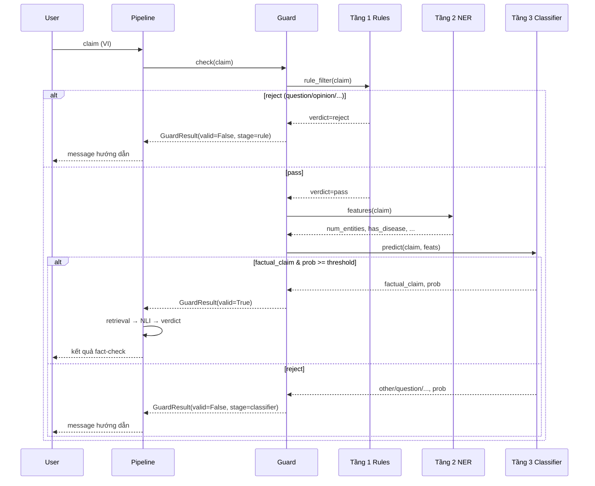

# Guard 3 tầng — Tài liệu triển khai

Tài liệu mô tả cơ chế **Guard 3 tầng** đang được áp dụng trong hệ thống fact-checking y khoa tim mạch (tiếng Việt). Mục tiêu: lọc input trước khi chạy retrieval/NLI, chỉ cho phép **factual claim** thuộc domain tim mạch đi tiếp pipeline.

> **Vị trí trong pipeline:** Guard là bước đầu tiên. Nếu `valid=False`, pipeline dừng ngay — không tốn tài nguyên retrieval, NLI, LLM.

---

## 1. Tổng quan kiến trúc

### 1.1 Mô hình cascade (thác nước)

Guard hoạt động theo kiểu **cascade**: tầng sau chỉ chạy khi tầng trước **pass** (trừ tầng 2 luôn chạy sau tầng 1 vì nó không reject độc lập).

```
Input (claim tiếng Việt)
        │
        ▼
┌───────────────────────┐
│ Tầng 1: Rule-based    │── reject sớm (question, opinion, diagnosis, command, too_short)
└───────────┬───────────┘
            │ pass
            ▼
┌───────────────────────┐
│ Tầng 2: Gazetteer NER │── trích entity y khoa → feature (KHÔNG tự reject)
└───────────┬───────────┘
            │
            ▼
┌───────────────────────┐
│ Tầng 3: Classifier    │── quyết định cuối: factual_claim vs other
│ (PhoBERT fine-tuned)  │
└───────────┬───────────┘
            │
     ┌──────┴──────┐
     ▼             ▼
  valid=True   valid=False
  → pipeline   → dừng + message cho user
```

### 1.2 Thiết kế nguyên tắc

| Nguyên tắc | Mô tả |
|------------|-------|
| **Reject sớm, rẻ** | Tầng 1 dùng regex/cue list — không cần GPU, latency ~ms |
| **Domain signal** | Tầng 2 gazetteer tim mạch — tín hiệu có/không có thuật ngữ y khoa |
| **Quyết định mềm** | Tầng 3 classifier kết hợp text + feature NER |
| **Vietnamese-first** | Toàn bộ Guard chạy trên tiếng Việt, trước retrieval/NLI |
| **Graceful degradation** | Không có model fine-tuned → fallback heuristic dựa NER |
| **Lazy-load model** | Classifier chỉ load khi cần → tiết kiệm RAM khi reject ở tầng 1 |

---

## 2. Chi tiết từng tầng

### 2.1 Tầng 1 — Rule-based filter

**File:** `src/guard/rules.py`

**Mục đích:** Loại sớm các input **chắc chắn** không phải factual claim, không cần ML.

#### Chuẩn hóa text

```python
def normalize(text: str) -> str:
    text = unicodedata.normalize("NFC", text)
    return re.sub(r"\s+", " ", text).strip().lower()
```

- Unicode NFC (chuẩn hóa dấu tiếng Việt)
- Lowercase
- Gộp khoảng trắng thừa

#### Các loại reject

| `reason` | Điều kiện | Ví dụ |
|----------|-----------|-------|
| `too_short` | < 4 token (sau normalize) | `"muối huyết áp"` |
| `question` | Kết thúc bằng `?` hoặc chứa cue hỏi | `"Cao huyết áp có nguy hiểm không?"` |
| `personal_opinion` | Chứa cue chủ quan | `"Tôi thấy uống trà gừng rất tốt cho tim"` |
| `personal_diagnosis` | Chứa cue chẩn đoán cá nhân | `"Tôi bị cao huyết áp đã 5 năm"` |
| `command` | Chứa cue mệnh lệnh/yêu cầu | `"Hãy tư vấn cho tôi chế độ ăn tốt cho tim"` |

#### Danh sách cue (có thể mở rộng)

- **QUESTION_CUES:** `có phải`, `tại sao`, `như thế nào`, `cho em hỏi`, ...
- **OPINION_CUES:** `tôi thấy`, `theo tôi`, `hình như`, `cảm giác`, ...
- **SELF_CUES:** `tôi bị`, `bác sĩ bảo tôi`, `kết quả của tôi`, ...
- **COMMAND_CUES:** `hãy `, `giúp tôi`, `tư vấn`, `hướng dẫn`, ...

#### Output

```python
@dataclass
class RuleResult:
    verdict: str          # "pass" | "reject"
    reason: str | None    # question | personal_opinion | personal_diagnosis | command | too_short
    matched: str | None   # cue khớp (debug)
```

---

### 2.2 Tầng 2 — Gazetteer NER

**File:** `src/guard/ner.py`

**Mục đích:** Trích xuất entity y khoa tim mạch từ claim, tạo **feature** cho classifier. **Không tự reject** — câu không có entity vẫn có thể pass nếu classifier cho phép (hoặc bị reject ở tầng 3).

#### Gazetteer (từ điển domain)

Thư mục: `data/gazetteer/`

| File | Nhãn entity | Ví dụ term |
|------|-------------|------------|
| `diseases.txt` | `DISEASE` | `cao huyết áp`, `nhồi máu cơ tim`, `suy tim` |
| `drugs.txt` | `DRUG` | `aspirin`, `statin`, `warfarin` |
| `substances.txt` | `SUBSTANCE` | `muối`, `omega-3`, `cholesterol` |
| `symptoms_measures.txt` | `SYMPTOM_MEASURE` | `huyết áp`, `nhịp tim`, `cholesterol ldl` |

Mỗi dòng trong file = một term (UTF-8). Comment bằng `#` nếu cần (khi dùng chung với `corpus_utils`).

#### Kỹ thuật matching

1. **Normalize** mọi term và input (cùng hàm `normalize` với tầng 1)
2. **Sort term theo độ dài giảm dần** → longest-match (tránh `"cơ tim"` che `"nhồi máu cơ tim"`)
3. **Regex** với lookaround thay `\b` (word boundary không ổn với tiếng Việt có dấu):

```python
self._regex = re.compile(rf"(?<![\wÀ-ỹ])({pattern})(?![\wÀ-ỹ])")
```

#### Output entity

```python
@dataclass
class Entity:
    text: str
    label: str      # DISEASE | DRUG | SUBSTANCE | SYMPTOM_MEASURE
    start: int
    end: int
```

#### Feature cho tầng 3

```python
{
    "num_entities": int,
    "has_disease": bool,
    "has_drug": bool,
    "has_substance": bool,
    "has_symptom_measure": bool,
    "entities": list[Entity],
}
```

---

### 2.3 Tầng 3 — PhoBERT Classifier

**File:** `src/guard/classifier.py`  
**Train script:** `scripts/train_guard_classifier.py`

**Mục đích:** Phân loại claim thành 5 nhãn, quyết định cuối có phải **factual claim** hay không.

#### Nhãn phân loại

```python
LABELS = [
    "factual_claim",       # ✅ pass Guard
    "question",
    "personal_opinion",
    "personal_diagnosis",
    "other",               # ngoài domain / không kiểm chứng được
]
```

#### Input format (feature fusion)

Feature NER được **prepend** vào text dưới dạng token đặc biệt, sau đó tách từ bằng `pyvi.ViTokenizer` (yêu cầu của PhoBERT):

```
[ENT=2] [DISEASE] [SUBSTANCE] ăn nhiều muối gây cao huyết áp
```

Hàm `build_input(text, ner_feats)` trong `classifier.py` thực hiện việc ghép này.

#### Model & inference

| Thành phần | Giá trị |
|------------|---------|
| Base model | `vinai/phobert-base-v2` |
| Task | `text-classification` (HuggingFace `pipeline`) |
| Max length | 256 tokens |
| Tokenizer | `pyvi.ViTokenizer.tokenize` trước khi đưa vào model |

#### Quyết định pass/reject

```python
if label == "factual_claim" and prob >= threshold:
    valid = True
else:
    valid = False
```

`threshold` mặc định: **0.5** (cấu hình trong `config.yaml`).

#### Fallback khi chưa có model fine-tuned

Nếu `classifier_path` không tồn tại → dùng heuristic NER:

| `num_entities` | Label | Confidence |
|----------------|-------|------------|
| ≥ 2 | `factual_claim` | 0.85 |
| = 1 | `factual_claim` | 0.65 |
| = 0 | `other` | 0.60 |

> Tầng 1 đã loại question/opinion/diagnosis nên fallback chỉ cần phân biệt claim y khoa vs câu lan man.

---

## 3. Orchestrator — lớp Guard

**File:** `src/guard/guard.py`

### Luồng `Guard.check(text)`

```python
def check(self, text: str) -> GuardResult:
    # Tầng 1
    rr = rule_filter(text)
    if rr.verdict == "reject":
        return GuardResult(valid=False, stage="rule", reason=rr.reason, ...)

    # Tầng 2
    feats = self.ner.features(text)

    # Tầng 3
    label, prob = self.classifier.predict(text, feats)
    if label == "factual_claim" and prob >= self.threshold:
        return GuardResult(valid=True, stage="classifier", confidence=prob, entities=feats["entities"])
    return GuardResult(valid=False, stage="classifier", reason=label, confidence=prob, ...)
```

### GuardResult

```python
@dataclass
class GuardResult:
    valid: bool
    stage: str                       # "rule" | "classifier"
    reason: str | None = None        # nhãn lý do khi reject
    message: str | None = None       # thông báo tiếng Việt cho người dùng
    confidence: float | None = None
    entities: list[Entity] = field(default_factory=list)
    matched_cue: str | None = None   # cue rule khớp (debug)
```

### Thông báo người dùng (`REJECT_MESSAGES`)

Mỗi `reason` có message hướng dẫn người dùng diễn đạt lại claim, ví dụ:

- `question` → "Đây là câu hỏi, không phải một khẳng định (claim)..."
- `personal_opinion` → "Đây là cảm nhận/ý kiến cá nhân..."
- `other` → "Câu này không phải khẳng định y khoa thuộc phạm vi tim mạch..."

---

## 4. Cấu hình (`config.yaml`)

```yaml
guard:
  # Đường dẫn model fine-tuned. null hoặc không tồn tại → fallback NER
  classifier_path: models/guard_phobert
  base_model: vinai/phobert-base-v2
  threshold: 0.5
  labels:
    - factual_claim
    - question
    - personal_opinion
    - personal_diagnosis
    - other
```

| Tham số | Mô tả |
|---------|-------|
| `classifier_path` | Thư mục chứa model + tokenizer sau khi train (`trainer.save_model`) |
| `base_model` | Checkpoint HuggingFace dùng khi train hoặc load |
| `threshold` | Ngưỡng confidence tối thiểu để chấp nhận `factual_claim` |
| `labels` | Danh sách nhãn (tham chiếu, đồng bộ với `LABELS` trong code) |

**Load config:**

```python
from src.config import load_config
cfg = load_config()  # đọc config.yaml ở project root
guard = Guard(cfg)
```

---

## 5. Huấn luyện classifier (tầng 3)

### 5.1 Dữ liệu train

**File:** `data/guard_train.csv`

```csv
text,label
Ăn nhiều muối gây cao huyết áp,factual_claim
Cao huyết áp có nguy hiểm không?,question
Tôi thấy uống trà gừng rất tốt cho tim,personal_opinion
...
```

Cần đủ mẫu cho 5 nhãn, ưu tiên cân bằng lớp.

### 5.2 Chạy training

```bash
python scripts/train_guard_classifier.py \
  --data data/guard_train.csv \
  --out models/guard_phobert \
  --base vinai/phobert-base-v2 \
  --epochs 8 \
  --batch 16
```

### 5.3 Pipeline training

1. Đọc CSV → với mỗi `text`, chạy `GazetteerNER.features()` → `build_input()` → `ViTokenizer.tokenize()`
2. Split train/val 80/20 (stratified theo `label_id`)
3. Fine-tune `AutoModelForSequenceClassification` với `Trainer`
4. Hyperparams: `lr=2e-5`, `max_length=256`, metric chọn model tốt nhất = `f1_macro`
5. Lưu model + tokenizer vào `--out`

### 5.4 Metric đánh giá

- Accuracy, F1 macro trên validation set
- Classification report theo từng nhãn

---

## 6. Tích hợp pipeline

**File:** `src/pipeline.py`

```python
class FactCheckPipeline:
    def __init__(self, config_path=None):
        cfg = load_config(config_path)
        self.guard = Guard(cfg)
        # ... retriever, nli, aggregator, verdict, explainer

    def run(self, claim_vi: str) -> PipelineResult:
        guard_result = self.guard.check(claim_vi)
        result = PipelineResult(claim_vi=claim_vi, guard=guard_result)
        if not guard_result.valid:
            return result  # early exit — không load retrieval/NLI

        evidences = self.retriever.retrieve(claim_vi)
        # ... NLI → aggregation → verdict → explanation
```

**Lazy-loading:** Retrieval, NLI chỉ được gọi sau khi Guard pass → tiết kiệm tài nguyên khi reject sớm.

### UI (Streamlit)

`app/streamlit_app.py` hiển thị:
- `st.error` + `st.info(g.message)` khi reject
- `st.success` + entities + confidence khi pass

### CLI

`run.py` in `[GUARD REJECT]` hoặc `[GUARD OK]` trước khi tiếp tục.

### Evaluation

Trong `scripts/eval_pipeline.py` và `src/evaluation/evaluator.py`, claim bị Guard reject được gán nhãn dự đoán `GUARD_REJECT` để tính metric riêng.

---

## 7. Công nghệ & dependencies

| Thành phần | Công nghệ |
|------------|-----------|
| Tầng 1 | Python `re`, `unicodedata` — không dependency ML |
| Tầng 2 | Regex longest-match trên gazetteer text file |
| Tầng 3 | PhoBERT (`vinai/phobert-base-v2`), HuggingFace Transformers, `pyvi` |
| Config | PyYAML |
| Train | `datasets`, `scikit-learn`, `transformers.Trainer` |

**requirements.txt (liên quan Guard):**

```
torch
transformers>=4.44
datasets
pyvi
scikit-learn
pyyaml
pandas
numpy
```

---

## 8. Cấu trúc file cần port sang hệ thống khác

```
src/guard/
├── __init__.py          # export Guard, GuardResult
├── guard.py             # orchestrator cascade
├── rules.py             # tầng 1
├── ner.py               # tầng 2
└── classifier.py        # tầng 3 + build_input + fallback

data/gazetteer/
├── diseases.txt
├── drugs.txt
├── substances.txt
└── symptoms_measures.txt

data/guard_train.csv     # dữ liệu train (tùy domain)

scripts/train_guard_classifier.py

config.yaml              # section guard: ...

tests/test_guard.py      # unit test rule + NER + cascade
```

---

## 9. Hướng dẫn triển khai tương tự ở hệ thống khác

### Bước 1 — Xác định domain & nhãn

- Giữ nguyên 5 nhãn nếu cùng use-case fact-checking y khoa
- Đổi domain khác: sửa gazetteer + dữ liệu train + `REJECT_MESSAGES`

### Bước 2 — Copy module Guard

1. Copy thư mục `src/guard/` nguyên vẹn
2. Copy `src/config.py` (hoặc tích hợp section `guard` vào config hiện có)
3. Đảm bảo `GAZETTEER_DIR` trỏ đúng path gazetteer trong project mới

### Bước 3 — Xây gazetteer domain

- Tạo file `.txt` theo loại entity (bệnh, thuốc, chất, triệu chứng/đo lường)
- Mỗi term một dòng, lowercase sau normalize
- Ưu tiên cụm dài, tránh term quá ngắn gây false positive

### Bước 4 — Tùy chỉnh rule tầng 1

- Bổ sung cue tiếng Việt đặc thù domain/user
- Điều chỉnh `MIN_TOKENS` nếu claim ngắn vẫn hợp lệ
- Thêm loại reject mới nếu cần (vd: `spam`, `off_topic`)

### Bước 5 — Chuẩn bị dữ liệu & train classifier

1. Thu thập ≥ 50–100 mẫu/nhãn (tối thiểu để fine-tune ổn)
2. Format CSV: `text,label`
3. Chạy `train_guard_classifier.py`
4. Cập nhật `guard.classifier_path` trong config

### Bước 6 — Gắn vào pipeline

```python
guard = Guard(cfg)
result = guard.check(user_input)
if not result.valid:
    return {"error": result.message, "stage": result.stage, "reason": result.reason}
# tiếp tục xử lý fact-checking...
```

### Bước 7 — Test

```bash
python tests/test_guard.py
# hoặc
pytest tests/test_guard.py
```

Test cases tham khảo:
- Reject: câu hỏi, ý kiến, chẩn đoán cá nhân, mệnh lệnh, quá ngắn
- Pass: factual claim có entity tim mạch
- Reject: câu không liên quan y khoa (`"Hôm nay trời đẹp..."`)
- NER longest-match: `"nhồi máu cơ tim"` không bị tách thành `"cơ tim"`

---

## 10. Tuning & mở rộng

### Điều chỉnh độ chặt

| Mục tiêu | Cách làm |
|----------|----------|
| Chặt hơn (ít false positive) | Tăng `threshold` (vd 0.6–0.7); bổ sung rule; mở rộng gazetteer |
| Lỏng hơn (ít false negative) | Giảm `threshold`; thêm mẫu `factual_claim` vào train set |
| Reject sớm hơn | Thêm cue vào `rules.py` |

### Tái sử dụng gazetteer

Gazetteer Guard được dùng chung với:
- `src/retrieval/corpus_utils.py` — lọc chunk corpus tim mạch khi build index (`corpus.filter.enabled`)
- `scripts/build_index.py` — filter bài viết theo term tim mạch

Khi đổi domain, cập nhật gazetteer một lần, cả Guard và RAG đều hưởng lợi.

### Thay model classifier

- Giữ nguyên interface `GuardClassifier.predict(text, ner_feats) -> (label, prob)`
- Có thể thay PhoBERT bằng PhoBERT-large, XLM-R, hoặc model đa ngữ khác — nhớ giữ bước tokenize phù hợp
- Feature fusion `[ENT=n] [DISEASE] ...` vẫn hữu ích với model nhỏ

---

## 11. Sơ đồ sequence



---

## 12. Ví dụ end-to-end

| Input | Tầng dừng | Kết quả |
|-------|-----------|---------|
| `"Cao huyết áp có nguy hiểm không?"` | 1 (rule) | `valid=False`, `reason=question` |
| `"Tôi bị cao huyết áp đã 5 năm"` | 1 (rule) | `valid=False`, `reason=personal_diagnosis` |
| `"Hôm nay trời đẹp và mọi người vui vẻ"` | 3 (classifier) | `valid=False`, `reason=other` |
| `"Ăn nhiều muối gây cao huyết áp"` | 3 (classifier) | `valid=True`, entities: muối (SUBSTANCE), cao huyết áp (DISEASE) |

---

## 13. Tham chiếu mã nguồn

| Thành phần | Path |
|------------|------|
| Orchestrator | `src/guard/guard.py` |
| Rule filter | `src/guard/rules.py` |
| Gazetteer NER | `src/guard/ner.py` |
| Classifier | `src/guard/classifier.py` |
| Train script | `scripts/train_guard_classifier.py` |
| Pipeline integration | `src/pipeline.py` |
| Unit tests | `tests/test_guard.py` |
| Config | `config.yaml` → section `guard` |
